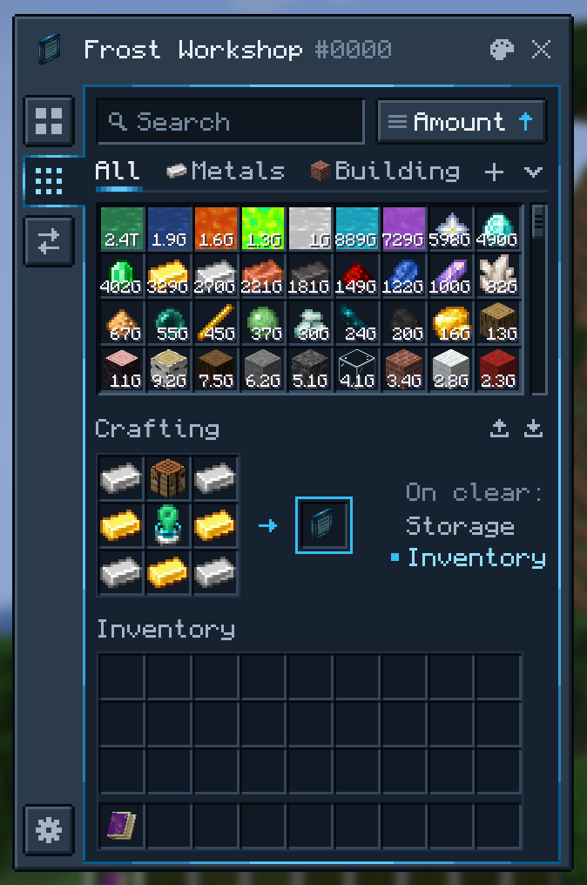
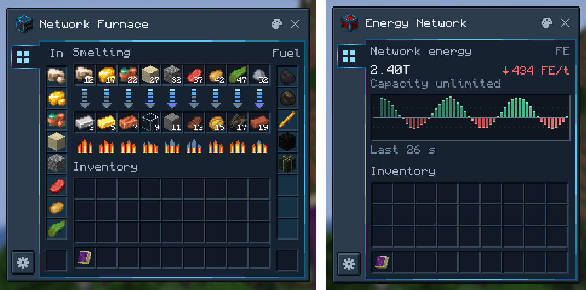
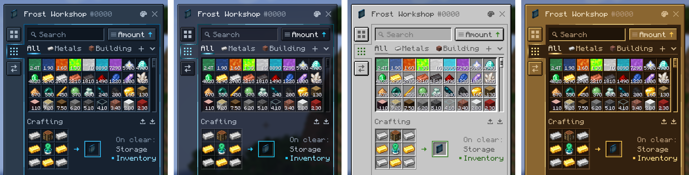

<div align="center">


# Beyond Dimensions

A storage mod for Minecraft. Store everything and access it from anywhere.

[](https://www.curseforge.com/projects/1222890)
[](https://discord.gg/AgnbJXeEXK)
[](LICENSE)

**English** | [简体中文](README.zh-CN.md)

</div>

## About

Beyond Dimensions adds the **Dimensional Network**: a storage system you can open anywhere with a hotkey, without keeping
any chunks loaded. Share it with friends and connect it to pipes, machines and other logistics mods.

## Features



### One network for everything

- Items, fluids and Forge Energy, plus chemicals, mana, source and warden souls when Mekanism, Botania, Ars Nouveau or
  Industrial Foregoing Souls is installed.
- Room for more than two billion kinds of resources and up to 2⁶³−1 of each.
- The screens work with containers: click a storage slot with a bucket, tank or other container to fill or empty it.

### A terminal for large collections

- Press <kbd>O</kbd> anywhere to open your network.
- Search by name or pinyin, or by mod `@`, tag `#`, tooltip `$`, resource ID `*`, resource type `~`, durability `%<50`
  and extra data `&`. Leave things out with `-` and allow alternatives with `|`.
- Make your own category tabs with icons, search rules and hand-picked resources.
- Sort by name, amount, mod, creative tab, stack size, first stored or last changed.
- Craft in the built-in grid, with recipe transfer from JEI and EMI.
- In survival, middle-click a block with an empty hand to take a stack of it from the network; sneak and middle-click
  to put the stack in your hand into the network.

<br clear="right">

### Machines

<p align="center">
  
</p>

| Block | What it does |
| --- | --- |
| Dimensional Network Pathway | Opens the whole network to pipes, hoppers and other mods' storage |
| Dimensional Network Energy Pathway | Does the same for Forge Energy, with a live flow graph, and can push energy out |
| Network Interface | Pulls resources out of the network, or takes them in from outside |
| Network Pump | Pulls resources from neighboring containers into the network |
| Network Hopper | Collects dropped items, XP orbs and fluids |
| Network Furnace, Blast Furnace and Smoker | Smelters that take inputs and fuel straight from the network |
| Stock Emitter | Emits a redstone signal while a resource in the network is above or below a threshold |
| Network Terminal | Opens the network with a crafting grid |
| Network Controller | Manages a network's members and permissions |

Machines have filters, per-side input and output settings and redstone control. The **Machine Configuration Talisman**
copies and pastes their settings in a few clicks.

### Tools

| Item | What it does |
| --- | --- |
| Portable Network Terminal | Your terminal, in the inventory or a Curios slot |
| Network Magnet | Collects dropped items, XP orbs and fluids |
| Network Feeder | Feeds you automatically |
| Network Restocker | Restocks your inventory automatically |
| XP Rod | Stores and returns experience, or keeps you at a set level |

### Shared networks

Each network has an owner, managers and members. Bind a **Member Connector** or **Manager Connector** to your network
and give it to another player; using it brings them in. A player in several networks picks a primary one in the network
switcher.

### Color schemes

<p align="center">
  
</p>

Choose from four color schemes (Beyond Dimensions Casing, Glass, Vanilla and Brass), or change any color in the
in-game editor, which opens from the palette button on each window. Resource packs can add schemes of their own.

## Getting started

1. Craft an **Unstable Space-Time Fragment** from a Nether Star, four Diamonds and four TNT.
2. Keep it in your inventory. After about an hour it becomes a **Stable Space-Time Fragment**.
3. Craft a **Dimensional Network Generator** and use it to create your network.
4. Press <kbd>O</kbd> to open the network.
5. Every ten minutes the network produces a **Shattered Space-Time Crystal**. Smelt crystals into **Space-Time Ingots**
   and craft them into **Stable Space-Time Frames**, which the mod's blocks and tools are made from.

## Compatibility

| Mod | What Beyond Dimensions adds |
| --- | --- |
| Applied Energistics 2 | The Dimensional ME Storage Cell puts a network into an ME system, with far better performance than a storage bus |
| Refined Storage | The RS Dimensional Pathway connects a network to an RS system |
| Mekanism | Chemical storage |
| Create | The Schematic Interface supplies Schematicannons from the network |
| Botania | Mana storage |
| Ars Nouveau | Source storage |
| Industrial Foregoing Souls | Warden soul storage |
| Just Enough Characters | Search uses its pinyin matching when it is installed |

## Installation

Download the file for your Minecraft version from [CurseForge](https://www.curseforge.com/projects/1222890); its file
page lists the dependencies it needs. Versions with the CompixelUI interface also need:

- [CompixelUI](https://www.curseforge.com/projects/1715758), the library its screens are built with;
- Kotlin: install [Kotlin for Forge](https://www.curseforge.com/minecraft/mc-mods/kotlin-for-forge), or use the
  CompixelUI file whose name ends in `-with-kotlin`, which includes it.

### Supported versions

| Minecraft | Loader | Branch | Status |
| --- | --- | --- | --- |
| 26.3 | NeoForge | [`26.3`](https://github.com/Frostbite-time/BeyondDimensions/tree/26.3) | Active |
| 26.2 | NeoForge | [`26.2`](https://github.com/Frostbite-time/BeyondDimensions/tree/26.2) | Active |
| 26.1 | NeoForge | [`26.1`](https://github.com/Frostbite-time/BeyondDimensions/tree/26.1) | Active |
| 1.21.11 | NeoForge | [`1.21.11`](https://github.com/Frostbite-time/BeyondDimensions/tree/1.21.11) | No longer updated |
| 1.21.1 | NeoForge | [`1.21.1`](https://github.com/Frostbite-time/BeyondDimensions/tree/1.21.1) | Active |
| 1.20.1 | Forge | [`1.20.1`](https://github.com/Frostbite-time/BeyondDimensions/tree/1.20.1) | Active |
| 1.12.2 | Forge | [`1.12.2`](https://github.com/Frostbite-time/BeyondDimensions/tree/1.12.2) | No longer updated |

## Guides

For modpacks and servers:

- [KubeJS](docs/en/kubejs.md): limit networks, add starting contents and build upgrade progressions with scripts
- [Storage rules](docs/en/storage-rules.md): refuse, convert and otherwise handle resources as they enter or leave a
  network
- [Color schemes](docs/en/color-schemes.md): customize the screens' colors and export them as a resource pack
- [Commands and configuration](docs/en/commands.md)

For add-on developers:

- [Networks and storage](docs/en/networks.md): find networks, store and take resources, listen to events and keep
  custom data on a network
- [Resource types](docs/en/resource-types.md): store a new kind of resource
- [Machine settings](docs/en/machines.md): settings that save, sync and work with the Machine Configuration Talisman
- [Screens](docs/en/screens.md): pages on Beyond Dimensions' screens, server actions and slot clicks

## For developers

[](https://maven.wintercogs.com/releases/com/wintercogs/beyonddimensions/beyonddimensions-1.21.1-neoforge/maven-metadata.xml)

Beyond Dimensions is published to the wintercogs Maven repository. Add it like this:

```groovy
repositories {
    maven { url = 'https://maven.wintercogs.com/releases' }
}

dependencies {
    implementation "com.wintercogs.beyonddimensions:beyonddimensions-1.21.1-neoforge:${beyond_dimensions_version}"

    // Development runs also need a Kotlin provider
    runtimeOnly "maven.modrinth:kotlin-for-forge:${kff_version}"
}
```

## Contributing

Report bugs in the [issue tracker](https://github.com/Frostbite-time/BeyondDimensions/issues). Pull requests are
welcome; please read [CONTRIBUTING.md](docs/CONTRIBUTING.md) first.

## License

Beyond Dimensions is released under the [MIT License](LICENSE). Third-party notices are listed in
[THIRD_PARTY_NOTICES.md](THIRD_PARTY_NOTICES.md).
