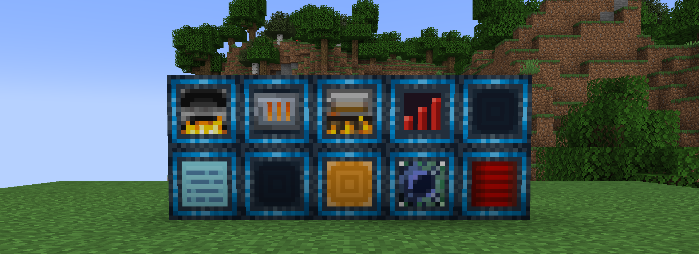
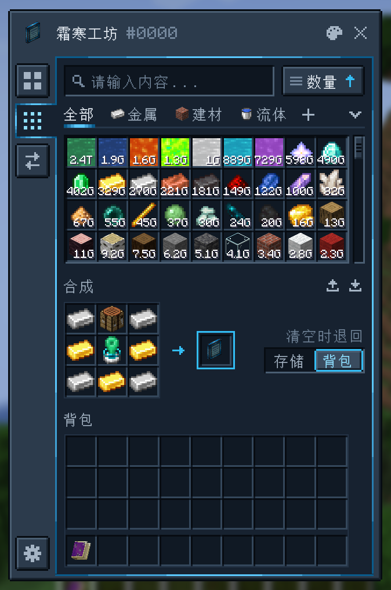
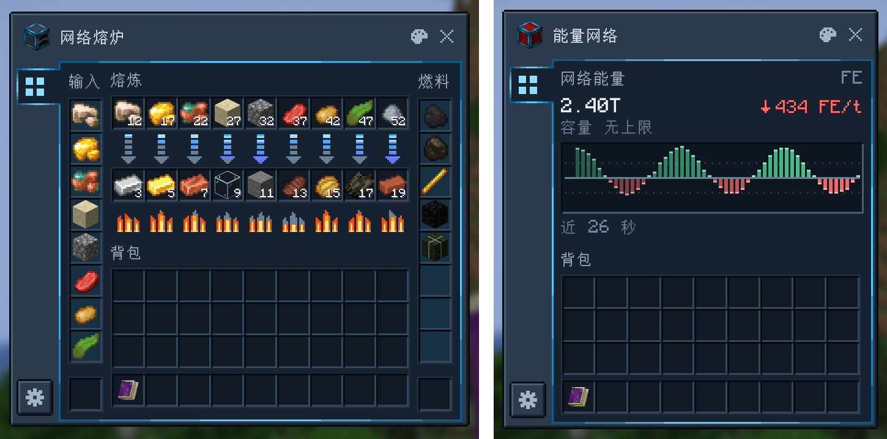
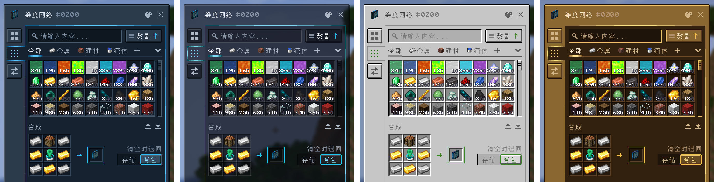

<div align="center">



# 超越维度 Beyond Dimensions

一个 Minecraft 存储模组。存储一切，随处访问。

[](https://www.curseforge.com/projects/1222890)
[](https://qun.qq.com/universal-share/share?ac=1&authKey=Ibpg3bzCDcd7hop8wWByfXSrLX%2FbWxey4nSK6IVaaJwTAEmmna69U%2B9RDKNpFYYA&busi_data=eyJncm91cENvZGUiOiIxMDQxNzk0OTExIiwidG9rZW4iOiJoVlIrUUdWN2prbnBTWnl5ZVhyOHkvYVZnc1hrbFY3WVN1TlAxaHJBd3NrWDNZcElZY1RkeTcxa3ZRU3F2QnNTIiwidWluIjoiMjIzOTgyODUyOCJ9&data=aCptLUim5SAxuzyBa-qtoNNUKjMcnN-4YEoHbXzfTmH7UbT_ZUcVZQzGLSqb1YmI9qz1LoqZ36yiNgcnhthcVg&svctype=4&tempid=h5_group_info)
[](https://www.mcmod.cn/class/19045.html)
[](LICENSE)

[English](README.md) | **简体中文**

</div>

## 简介

超越维度带来了**维度网络**：一个无需区块加载、可通过快捷键在任何地方打开的存储系统。网络可以与朋友共享，也可以接入管道、机器和其他物流模组。

## 功能



### 一个网络存下一切

- 支持物品、流体和 FE 能量；安装通用机械、植物魔法、新生魔艺或工业先锋：灵魂涌动后，还支持化学品、魔力、魔源和监守者之魂。
- 最多存二十多亿种资源，每种最多 2⁶³−1 个。
- 界面支持容器交互：手持桶、储罐等容器点击存储格，即可装入或倒出。

### 为海量存储设计的终端

- 随时按 <kbd>O</kbd> 打开网络。
- 搜索支持名称和拼音，也支持按模组 `@`、标签 `#`、提示文字 `$`、资源 ID `*`、资源类型 `~`、耐久 `%<50` 和额外数据 `&` 搜索；`-` 表示排除，`|` 表示“或”。
- 可以自建分类页，设置图标和搜索规则，以及标记特定资源。
- 能按名称、数量、模组、创造标签页、最大堆叠、存入时间或变动时间排序。
- 自带合成格，可以从 JEI 和 EMI 转移配方。
- 生存模式下，空手对准方块按中键，可从网络取出一组该方块；潜行时按中键，可将手中的物品存入网络。

<br clear="right">

### 机器

<p align="center">
  
</p>

| 方块 | 作用 |
| --- | --- |
| 维度网络通道 | 管道、漏斗和其他模组的存储能通过它访问整个网络 |
| 维度网络能量通道 | FE 能量的通道，带实时流量图，并可向外输出能量 |
| 网络接口 | 从网络中取出资源，或从外部接收资源 |
| 网络泵 | 从相邻容器抽取资源存入网络 |
| 网络漏斗 | 收集掉落物、经验球和流体 |
| 网络熔炉、网络高炉、网络烟熏炉 | 直接从网络中取用原料和燃料的冶炼设备 |
| 存量发信器 | 网络里某种资源高于或低于阈值时，发出红石信号 |
| 网络终端 | 打开带合成格的网络界面 |
| 网络控制器 | 管理网络成员和权限 |

机器均支持过滤、分面输入输出和红石控制，并可通过**机器配置卡**快速复制、粘贴设置。

### 工具

| 物品 | 作用 |
| --- | --- |
| 便携网络终端 | 放在背包或饰品栏里的终端 |
| 网络磁铁 | 收集掉落物、经验球和流体 |
| 网络喂食器 | 自动喂食 |
| 网络补货器 | 自动补货 |
| 经验棒 | 存取经验，或维持经验等级 |

### 共享网络

网络有所有者、管理员和成员三种身份。将**成员连接符**或**管理员连接符**绑定到网络，交给其他玩家使用后，对方即可加入。加入多个网络的玩家可以在主网络切换器中选择主网络。

### 配色

<p align="center">
  
</p>

界面提供超维机壳、玻璃、原版、黄铜四种配色。点击窗口上的调色板按钮可以切换配色，也可以在游戏内修改任意颜色。资源包可以添加自定义配色。

## 快速上手

1. 用下界之星、四颗钻石和四个 TNT 合成**不稳定时空碎片**。
2. 将其放在背包中，约一小时后转化为**稳态时空碎片**。
3. 合成**维度网络发生器**，用它建立你的网络。
4. 按 <kbd>O</kbd> 打开网络。
5. 网络每十分钟产出一个**破碎的时空结晶**。将结晶烧炼成**时空锭**，再合成**稳定的时空框架**，超越维度的方块和工具都以它为材料。

## 模组联动

| 模组 | 联动内容 |
| --- | --- |
| 应用能源 2 | 通过维度ME磁盘将网络接入 ME 系统，性能远超存储总线 |
| 精致存储 | 通过 RS维度通道将网络接入 RS 系统 |
| 通用机械 | 存化学品 |
| 机械动力 | 蓝图接口使蓝图加农炮可以直接从网络获取材料 |
| 植物魔法 | 存魔力 |
| 新生魔艺 | 存魔源 |
| 工业先锋：灵魂涌动 | 存监守者之魂 |
| 通用拼音搜索（JECh） | 安装后，搜索使用它的拼音匹配 |

## 安装

在 [CurseForge](https://www.curseforge.com/projects/1222890) 下载对应 Minecraft 版本的文件，所需前置以文件页面为准。使用 CompixelUI 界面的版本还需要安装：

- [CompixelUI](https://www.curseforge.com/projects/1715758)：超越维度的界面库；
- Kotlin：安装 [Kotlin for Forge](https://www.curseforge.com/minecraft/mc-mods/kotlin-for-forge)，或使用文件名以 `-with-kotlin` 结尾、自带 Kotlin 的 CompixelUI。

### 版本支持

| Minecraft | 加载器 | 分支 | 状态 |
| --- | --- | --- | --- |
| 26.3 | NeoForge | [`26.3`](https://github.com/Frostbite-time/BeyondDimensions/tree/26.3) | 更新中 |
| 26.2 | NeoForge | [`26.2`](https://github.com/Frostbite-time/BeyondDimensions/tree/26.2) | 更新中 |
| 26.1 | NeoForge | [`26.1`](https://github.com/Frostbite-time/BeyondDimensions/tree/26.1) | 更新中 |
| 1.21.11 | NeoForge | [`1.21.11`](https://github.com/Frostbite-time/BeyondDimensions/tree/1.21.11) | 已停更 |
| 1.21.1 | NeoForge | [`1.21.1`](https://github.com/Frostbite-time/BeyondDimensions/tree/1.21.1) | 更新中 |
| 1.20.1 | Forge | [`1.20.1`](https://github.com/Frostbite-time/BeyondDimensions/tree/1.20.1) | 更新中 |
| 1.12.2 | Forge | [`1.12.2`](https://github.com/Frostbite-time/BeyondDimensions/tree/1.12.2) | 已停更 |

## 指南

整合包和服务器：

- [KubeJS](docs/zh-CN/kubejs.md)：通过脚本限制网络、添加初始物资、设计升级流程
- [存储规则](docs/zh-CN/storage-rules.md)：在资源进出网络时进行拒收、转换等处理
- [配色](docs/zh-CN/color-schemes.md)：自定义界面配色并导出为资源包
- [命令与配置](docs/zh-CN/commands.md)

附属开发：

- [网络与存储](docs/zh-CN/networks.md)：查找网络、存取资源、监听事件，以及在网络上保存自定义数据
- [资源类型](docs/zh-CN/resource-types.md)：让网络存储新的资源类型
- [机器设置](docs/zh-CN/machines.md)：可自动保存、同步，并支持用机器配置卡复制的设置
- [界面](docs/zh-CN/screens.md)：为超越维度的界面添加页面、向服务器发送动作、修改槽位点击行为

## 开发者

[](https://maven.wintercogs.com/releases/com/wintercogs/beyonddimensions/beyonddimensions-1.21.1-neoforge/maven-metadata.xml)

超越维度发布在 wintercogs Maven 仓库，可通过以下方式引入：

```groovy
repositories {
    maven { url = 'https://maven.wintercogs.com/releases' }
}

dependencies {
    implementation "com.wintercogs.beyonddimensions:beyonddimensions-1.21.1-neoforge:${beyond_dimensions_version}"

    // 开发环境运行时还需要 Kotlin 提供者和超越维度的拼音库
    runtimeOnly "maven.modrinth:kotlin-for-forge:${kff_version}"
    additionalRuntimeClasspath "com.github.promeg:tinypinyin:2.0.3"
}
```

## 参与贡献

问题请在 [Issues](https://github.com/Frostbite-time/BeyondDimensions/issues) 中反馈。提交代码前，请先阅读[贡献指南](docs/CONTRIBUTING.md)。

## 许可证

超越维度以 [MIT 许可证](LICENSE) 发布，第三方声明见 [THIRD_PARTY_NOTICES.md](THIRD_PARTY_NOTICES.md)。
